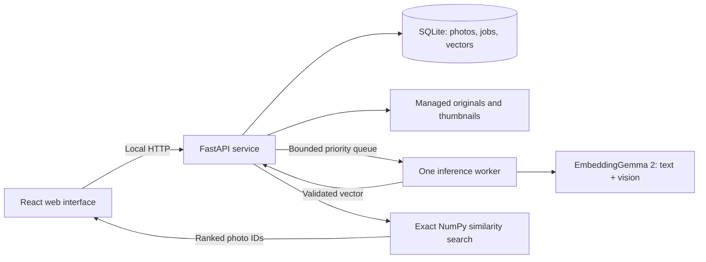

# Indexer Alpha — photo search proof of concept

**Status:** Implemented; measured results and remaining validation limits are recorded in [VALIDATION.md](VALIDATION.md).
**Date:** October 28, 2026
**Scope:** Approximately 20 photos, one user, running locally on this Windows PC.

## 1. The product

Indexer Alpha is a personal photo library that finds pictures from a description of what is visible in them.

The user adds about 20 photos, waits for indexing, and searches with phrases such as “a dog running on the beach,” “a red car parked near trees,” or “people eating outside at night.” The application returns the actual photos, ordered by visual relevance. Clicking a result opens a larger preview.

The deliverable is a working photo application with a Google Photos-inspired light web interface and real model inference. The old repository and documentation site have been removed. The name **Indexer Alpha** is retained.

## 2. Proof-of-concept boundaries

| Included | Deferred |
| --- | --- |
| Import approximately 20 photos through drag-and-drop or a file picker | Folder watching, recursive filesystem indexing, cloud photo connectors |
| JPEG, PNG, and WebP | HEIC, camera RAW, video, audio, animated formats |
| Image embeddings from EmbeddingGemma 2 | Caption generation, face identification, OCR, generative answers |
| Search using a natural-language description | Automatic interpretation of dates or locations as strict filters |
| Ranked gallery, larger preview, filename and dimensions | Albums, collaborative libraries, editing, deduplication workflows |
| Persistent images and embeddings; retry interrupted indexing | Large-library ANN infrastructure, distributed jobs, multiuser accounts |
| Remove imported items and reset the demo library | Modification or deletion of source photos on the user's computer |
| Desktop-first responsive interface | Public hosting, remote access, mobile installation |

Import creates a managed copy on this computer. The original photo is untouched. The browser sends photos only to the local service. The initial model download requires internet access; indexing and search must work offline once the model is cached.

The validation dataset is 20 images. Performance or scalability claims beyond this working set are outside this proof of concept.

## 3. Model choice and retrieval behavior

Use the official `google/embeddinggemma-2` checkpoint through Sentence Transformers and PyTorch. Google documents a shared embedding space for text and images and selective loading of the vision and audio components. For this application, load the text backbone and vision encoder, with `audio_config: None`. This is the roughly 440M-parameter text-and-image configuration. Use the complete embedding pipeline, including pooling and projection, rather than treating vision-tower features as search vectors. [Google model card](https://ai.google.dev/gemma/docs/embeddinggemma/model_card_2)

Use BF16 where the runtime confirms support, otherwise FP32. Do not use FP16: Google's model guidance warns of invalid or degraded outputs. Keep the native 768-dimensional vectors; dimensional compression is unnecessary for 20 photos. [Google inference guidance](https://ai.google.dev/gemma/docs/embeddinggemma/model_card_2#4-numerical-precision)

The image path uses the official processor and one image input per embedding. Start with the documented default vision token budget of 280. Images receive no text-task prefix. Text queries use the documented search-query formatting, validated against actual image retrieval during the first milestone. Pin the processor settings and query formatting after that check. [Multimodal inference guide](https://ai.google.dev/gemma/docs/embeddinggemma/multimodal-embeddinggemma-with-sentence-transformers), [task-prefix guidance](https://ai.google.dev/gemma/docs/embeddinggemma/model_card_2#1-task-instruction-prefixes)

### Indexing

1. Stream an uploaded photo into a temporary local file and validate it.
2. Correct EXIF orientation and convert its pixels to the processor's expected color format.
3. Generate a thumbnail and a bounded-size preview, separate from the inference input.
4. Pass the image through EmbeddingGemma 2's image embedding pipeline.
5. Convert the result to FP32; verify its shape, finite values, and nonzero norm; L2-normalize it.
6. Save the embedding and mark the photo searchable in one SQLite transaction.
7. Release image buffers and temporary tensors before processing the next photo.

Filenames and metadata do not influence semantic ranking. The proof must demonstrate that the model searches visual content.

### Searching

1. Submit the description with Enter or the Search button.
2. Produce and normalize a text embedding with the same model revision and embedding settings.
3. Compute a dot product against each normalized image vector. This is exact cosine-similarity ranking.
4. Ranked mode returns all indexed photos in relevance order. Filtered mode displays only photos at or above the chosen percentage cutoff, retaining relevance order.
5. Keep an entered query visible and provide a clear action to return to the full library.

Twenty FP32 vectors of 768 dimensions occupy **61,440 bytes, or 60 KiB**, before metadata. A small NumPy matrix and SQLite BLOB storage are sufficient. No separate vector database or approximate-nearest-neighbor index is needed.

Similarity is a ranking signal, not a calibrated probability. Do not display a misleading “93% confidence” badge. Search tiles display similarity percentages at their top right, accompanied by an explanation that they measure similarity rather than certainty. The percentage is cosine similarity multiplied by 100, clamped to 0–100 and rounded to one decimal. Filtered mode applies an inclusive cutoff to that displayed value; its default is 70%, adjustable from 0–100% with 60/70/80% shortcuts. Ranked mode has no cutoff. The top result is not automatically rescaled to 100%. Queries involving exact counts, negation, tiny details, or personal identities may be unreliable and must not be presented as guaranteed matches.

## 4. User experience

### First launch

The main screen introduces Indexer Alpha with the prompt **“Find the photo you're thinking of.”** It provides a photo drop zone, a Choose photos button, and a compact model setup panel showing download progress or readiness. Explain that photos stay on this computer.

Show the model download size from the selected artifact's metadata before downloading. Selective encoder loading reduces active memory; it does not necessarily mean that the downloaded checkpoint excludes audio weights.

### Import and indexing

The user selects up to 20 images in one import. Thumbnails appear as files are accepted. Each tile shows a real state: queued, indexing, ready, or failed. A compact status strip reads, for example, “12 of 20 photos searchable,” with pause/resume and retry-failed actions.

Search becomes available as soon as the first photo is ready. If indexing is incomplete, results state how many ready photos were searched. Closing the browser does not terminate the local service or its indexing job. Stopping the service persists unfinished work for the next launch.

### Library and results

Use a prominent search field above a responsive grid. Tiles prioritize the photograph, with filenames revealed on hover/focus or in the detail view. Preserve the image's aspect ratio with `object-fit: contain`; do not crop away the detail the user searched for.

Provide a small library count, Add photos action, and clear states for an empty library, model loading, indexing in progress, failed import, and search failure. Sample-query chips must be visibly examples, not claims about the contents of the user's library.

### Photo detail

A keyboard-accessible dialog shows a larger preview, filename, dimensions, file size, indexing state, and a Remove from library action. Arrow keys move through the current result ordering; Escape closes the dialog and restores focus to the selected tile.

Removing a photo deletes its managed copy, derivatives, and embedding. The confirmation explicitly says the original source file is unaffected. A reset action clears the imported library while retaining the downloaded model cache unless the user separately chooses to remove it.

## 5. Google Photos-inspired design system

The specification was written before implementation. The subsequent request to match Google Photos supersedes the original dark glassmorphic direction. Keep the Indexer Alpha name and its own logo.

Use React, TypeScript, Vite, Tailwind CSS, Lucide icons, Radix accessible dialogs, and shared shadcn-style button variants. Solid surfaces keep contrast predictable without blur over photographs.

| Token or layout | Value |
| --- | --- |
| Page background | `#F8FAFD` |
| Photo panel | `#FFFFFF` |
| Search field | `#E9EEF6` |
| Selected navigation | `#D3E3FD` |
| Primary action | `#0B57D0` |
| Main / secondary text | `#202124` / `#5F6368` |
| Desktop header | Logo, prominent top search bar, settings |
| Sidebar | Add photos, Photos, Favorites, Settings, storage |
| Gallery | Justified rows, original aspect ratios, 4 px gaps |
| Mobile | Search below the logo; navigation becomes a drawer |

Keep keyboard focus visible and controls usable without hover. Respect reduced-motion preferences. Photos load lazily; the viewer uses bounded previews. The desktop gallery fills the main panel immediately below the search/header area. On narrow screens, the grid adapts without horizontal scrolling.

## 6. Local architecture

**Frontend:** React, TypeScript, Vite, shared shadcn-style controls, Radix dialogs, Tailwind CSS, Lucide. One application screen and a detail dialog; a full routing framework is optional and unnecessary initially.

**Backend:** Python 3.12 target, FastAPI/Uvicorn, SQLite, NumPy, Pillow, Sentence Transformers, Transformers, and PyTorch. Pin working versions and the model revision after the compatibility milestone; do not depend on unpinned nightly packages.

**Process layout:** One API process and one spawned inference process. The API owns database writes and exact ranking. The worker owns the only loaded model instance. It receives paths and short queries, not an entire photo collection. Starting another browser tab must not load another model. Do not initialize the model in multiple Uvicorn workers.

**Transport:** Normal HTTP for actions and search, server-sent events for indexing progress. Reconnecting clients fetch current persisted state before consuming new updates.

**Running it:** A Windows start command launches the service and prints the local web interface URL. The production service serves the built frontend and API from the same origin. A stop command shuts down both API and worker. The build will document installation, model setup, start, stop, and reset. Docker and a database server are not required.

**Local data:** Store managed originals, thumbnails, previews, SQLite, and model artifacts in a configurable application-data directory outside the source checkout. Keep a manifest with the model revision and processing configuration. Never store photos or weights in Git.

## 7. Memory and resource management

The inspected PC has approximately **31.7 GiB system RAM**, an **Intel i7-11800H**, and an **NVIDIA RTX 3080 Laptop GPU with 16 GiB VRAM**. The installed runtime confirms CUDA and BF16 support.

The following are engineering targets for this machine, not measured results or model-vendor guarantees:

| Resource | Initial target |
| --- | --- |
| Combined backend private memory | At or below 4 GiB during the 20-photo workflow |
| Worker GPU reserved memory | At or below 4 GiB during normal indexing/search |
| Browser tab private memory | Below 300 MiB with the full gallery and one preview |
| Inference batch | One photo or one text query at a time |
| Image decode concurrency | One full-resolution image at a time |
| Upload concurrency | Two files maximum, streamed to disk |
| Decoded image limit | 64 megapixels; 16 bytes/pixel plus 256 MiB reserve checked against available RAM |
| Upload limit | 25 MiB per photo; 20 files per import |
| Idle model release | Shut down the worker after five idle minutes with no jobs |

If profiling disproves a target, record the measured result and change the design before expanding scope. Do not silently increase limits until a run happens to pass.

### Required controls

- Load only text and vision; never instantiate an unused audio model.
- Run inference with gradients disabled and avoid retaining computation graphs or hidden states.
- Persist jobs in SQLite. The in-memory queue contains only the next few IDs; it never holds all decoded images.
- Use streaming uploads and close file handles promptly. Reject malformed files, oversized pixel dimensions, and unsupported formats with a useful tile-level error.
- Estimate decoding memory including RGB conversion and resize copies. Reject an image that cannot fit the conservative decode budget before processing it.
- Close Pillow images, discard array/tensor references, and finish each indexing item before opening the next one.
- Keep thumbnails and previews on disk. Serve thumbnails to the grid, a bounded preview to the dialog, and avoid loading full originals into every browser tile.
- Revoke temporary browser object URLs after upload or removal. Cancel abandoned requests and ignore results belonging to an obsolete search.
- Give interactive text queries priority between image jobs. An executing GPU operation is allowed to finish; cancellation must not pretend to interrupt it midway.
- Track process memory plus GPU allocated and reserved memory separately. PyTorch's cache can retain reserved memory after tensors are released; cache clearing alone is not a model unload. Worker termination is the reliable idle-release boundary. [PyTorch memory-management documentation](https://docs.pytorch.org/docs/2.14/notes/cuda.html#cuda-memory-management)
- On GPU out-of-memory, checkpoint the job, terminate the failed worker, and show a retry/CPU-mode option. Never loop indefinitely or quietly switch to unsafe FP16.
- Keep preview files and logs bounded; remove derivatives when an imported item is removed. Report disk-full errors without marking an incomplete photo ready.

## 8. Persistence and lifecycle

Use a small SQLite schema:

- **Photos:** ID, display filename, managed relative path, dimensions, byte size, thumbnail/preview paths, status, timestamps, and error message.
- **Embeddings:** photo ID, pipeline identity containing the model revision, and vector BLOB. Dimension and dtype are fixed by the manifest/pipeline.
- **Jobs:** state, attempts, and last error are stored on the photo row for this small library.
- **Settings:** preferred compute mode, pause state, cached snapshot path, and model revision. The data directory is configured through the environment.

The embedding and ready state commit together. Temp-file promotion and database changes are reconciled on startup: abandoned temp files and generated orphan files are cleaned and interrupted jobs return to the queue. An image with a missing managed file cannot appear as a healthy result.

Readiness states are `queued`, `indexing`, `ready`, and `failed`. Pause prevents the next job from starting. Removing an in-flight photo records cancellation so its late worker result cannot recreate it.

Embeddings with a different model revision, dimension, or processor/query configuration must not be mixed. A configuration change marks the library for reindexing. Restarting with unchanged configuration reuses stored vectors immediately.

## 9. Local API outline

| Operation | Purpose |
| --- | --- |
| `GET /api/status` | Model state, device, counts, and resource summary |
| `POST /api/model/download` | Explicit initial model setup with progress |
| `POST /api/photos` | Stream and queue imported photos |
| `GET /api/photos` | List the small library and indexing states |
| `GET /api/photos/{id}/thumbnail` | Serve a thumbnail |
| `GET /api/photos/{id}/preview` | Serve a bounded-size detail image |
| `POST /api/search` | Encode a description and return ranked photo IDs |
| `POST /api/indexing/pause`, `/resume`, `/retry` | Control indexing |
| `DELETE /api/photos/{id}` | Remove managed data for one photo |
| `POST /api/library/reset` | Clear the imported demo library |
| `GET /api/events` | Stream progress and state changes |

Bind to loopback only. Media routes resolve opaque photo IDs against managed paths, never arbitrary filesystem paths supplied by a client. Enforce same-origin requests, allowed Host headers, and a local launch-session mechanism for state-changing actions. No photo uploads, telemetry, or search requests go to an external API.

## 10. Validation and acceptance

### Retrieval quality

Use 20 real photos (public samples until the user supplies their own) spanning several distinct subjects, with some intentionally similar scenes. Before tuning, define ten descriptions and which images a person considers relevant. Reserve a few queries for final validation.

The initial quality target is at least one relevant image in the top three for **8 of 10 queries**. This is an acceptance target to measure, not a claim about the untested model. Test a second phrasing for several queries. Do not use filenames, injected tags, or generated captions to make the result appear correct.

### Functional checks

- All 20 valid photos receive real persisted embeddings; malformed inputs show individual errors.
- Search uses the real model and changes the result ordering when the description changes.
- The gallery, keyboard detail viewer, remove action, and progress controls work.
- Restarting the application retains the library and rankings without re-embedding unchanged photos.
- An interrupted import/indexing run recovers without duplicate records or missing-file results.
- With network access disabled after setup, import, indexing, search, and preview still work.
- Imported source files outside the managed directory remain unchanged.

### Performance and resource checks

- Warm-query target: median at or below 500 ms and p95 at or below 1 second on the inspected GPU for this 20-photo dataset. Measure text inference separately from ranking and rendering.
- Measure cold model load and total 20-photo indexing time; show actual progress and report observed times without a promised throughput number.
- Run 100 searches and repeatedly open/close previews. After warm-up, backend and browser memory should settle, with no sustained growth above 10% over the steady-state baseline.
- Confirm one model copy across multiple tabs, successful idle worker exit, and GPU memory returning close to its pre-worker baseline after shutdown.
- Test failure paths for worker exit, simulated OOM, disk full, and a file removed during indexing.
- Check desktop and narrow layouts, keyboard navigation, reduced motion, and readable contrast.

The final handoff includes observed memory/latency figures and retrieval results. A polished mock UI alone does not satisfy this proof of concept.

## 11. Build order

1. **Model compatibility and retrieval proof.** Load the official model with audio disabled on this PC, produce finite image/text vectors, verify precision and preprocessing, and test a handful of real photo descriptions. Record working versions and memory usage. Resolve a model/runtime mismatch before investing in the interface.
2. **Persistent local workflow.** Implement bounded import, the single inference worker, SQLite storage, exact ranking, recovery, and local serving. Prove import → index → search → restart on the 20-photo set.
3. **Google Photos-inspired interface.** Build the designed gallery, search, detail view, indexing states, and setup flow against the real API.
4. **Validation and handoff.** Run the acceptance checks, record results, and provide a simple Windows start/stop workflow.

Implementation is complete. See README.md for setup and VALIDATION.md for measured results, the public-sample corpus, and limitations. User-photo retrieval quality remains to be checked when those photos are supplied.

## 12. Pinned implementation

Model revision: `f9972ac22e696a105c482202646979e33e4b5a1e`. Pipeline: `image280-searchquery-v1`. Versions are locked in `uv.lock` and `package-lock.json`. Local URL: `http://127.0.0.1:8765`. The library has a 100-photo safety cap and the tested working set is 20. Pending queries are bounded to four. One model process serves all browser tabs.

## Search controls update

Search is scoped to the current page. `POST /api/search` accepts `scope: "photos" | "favorites"` (default `photos`). The backend selects only ready embeddings within that scope before ranking, and returns the scope and searched count. Favorites searches preserve the Favorites tab, placeholder, back action, counts, and viewer order in both Ranked and Filtered modes. Removing a favorite removes it from visible favorites results. No searchable favorites produces an empty response without model inference or fallback to the full library. Navigation cancels an in-progress search and ignores its late reply.

Modes and cutoff changes filter the existing ranked response in the browser without repeating model inference. A zero-match definitive search shows an explicit empty state with controls to lower the cutoff or return to Ranked. Percentages appear only during search; favorites move below the percentage overlays. The sidebar “Private by design” badge and the top-bar settings icon have been removed; Settings remains accessible through the sidebar/mobile navigation.

The Ranked/Filtered controls sit to the right of the search field. Desktop shows icons and labels; mobile shows accessible icon buttons. Hover or keyboard focus reveals explanations, and Escape dismisses the tooltip. Only Filtered mode exposes cutoff controls. Recently added and the gallery shield footer have been removed.
